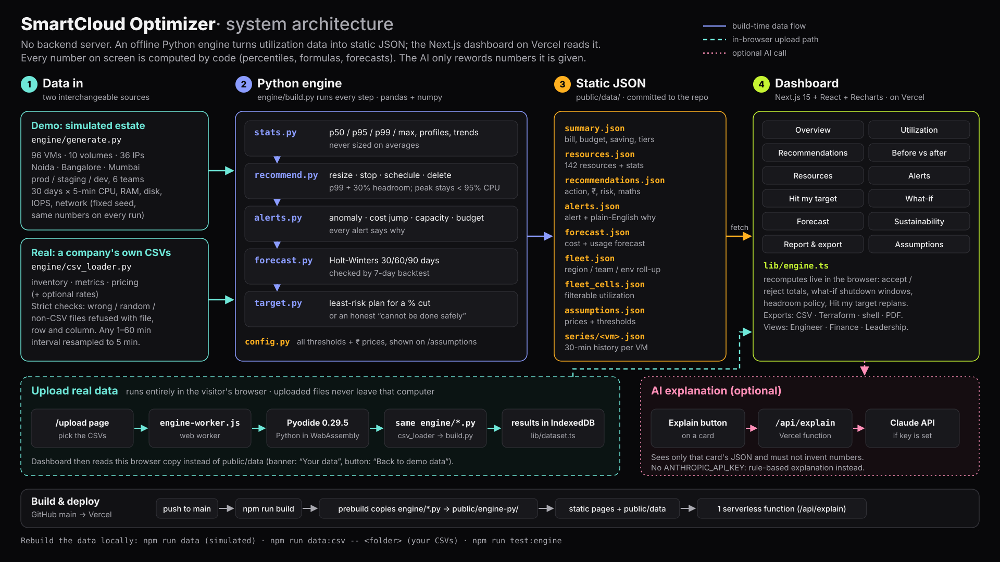

# SmartCloud Optimizer

**TransfiNITTe 2026 · UTHO problem statement.** SmartCloud Optimizer turns cloud utilization data into decisions an infrastructure engineer can trust: what to resize, stop, delete or schedule, how much each change saves, and how risky it is. Every rupee comes with the formula behind it.

## What it does

| Must-have (from the brief) | Where |
|---|---|
| Fleet utilization dashboard: CPU, memory, storage and network over 30 days, by region/team/env, top consumers | `/utilization` |
| Per-resource utilization (CPU, memory, disk, network, IOPS), filter by region/env/team, drill into history | `/resources`, `/resources/[id]` |
| Rightsizing engine based on **p99 peak + 30% headroom**, never averages | `engine/recommend.py` |
| Actionable recommendations: action, reason, ₹ saving, risk, confidence | `/recommendations` |
| Before vs after cost, accept/reject with live totals | `/savings`, sticky footer |
| Alerts that explain why: anomaly, cost jump, capacity, budget overrun | `/alerts`, `engine/alerts.py` |

**Bring your own data** (`/upload`, the Upload real data button): drop a company's own `inventory.csv`, `metrics.csv` and `pricing.csv`. Every file, row and column is checked against a strict format (wrong, random or non-CSV files are refused with the file, row and column), then the same Python engine analyses them inside the browser. The format and the acceptance criteria are in [`DATA_FORMAT.md`](DATA_FORMAT.md).

Bonus: **Hit my target** (`/target`: type "cut 15%", get the least risky plan that reaches it, or an honest "cannot be done safely"; `engine/target.py`), 30/60/90-day forecast (Holt-Winters), what-if simulator (shutdown windows + headroom policy), AI plain-language explanations (Claude, with rule-based fallback), CSV / Terraform / shell / PDF export, sustainability (kWh, CO₂), Engineer / Finance / Leadership views.

**The safety showcase:** `prod-reports-01` averages ~10% CPU but hits ~80% every day at 10:00. An average-based tool would shrink it to 2 vCPU (peak → 322%). Our engine refuses and explains why. Similarly, `prod-pay-api-07` has an active anomaly, so sizing is paused instead of "learning" the incident.

## Architecture



How to read it (left to right):

1. **Data in**: either the simulated demo estate (`engine/generate.py`, fixed seed) or a company's own CSVs (`engine/csv_loader.py`, strict checks).
2. **Python engine**: `engine/build.py` runs stats → recommendations → alerts → forecast → Hit my target. Thresholds and prices come from `engine/config.py`.
3. **Static JSON**: the results land in `public/data/*.json`, committed to the repo.
4. **Dashboard**: Next.js pages read that JSON; `lib/engine.ts` recomputes accept/reject, what-if and target plans live.

Solid blue arrows are the build-time data flow. The dashed green path is **Upload real data**: the same Python files run in
the visitor's browser (Pyodide) and the results stay in that browser. The dotted pink path is the optional **AI explanation**,
which only rewords the numbers on one card and falls back to a rule-based text when no API key is set. A PNG copy is at
[`docs/architecture.png`](docs/architecture.png).

There is no backend server. The engine is an offline Python pipeline that writes static JSON; the Next.js dashboard
(hosted on Vercel) reads that JSON. The only server-side code is the optional `/api/explain` route (a Vercel serverless
function). Uploaded CSVs are processed by the same Python files running in the visitor's browser (Pyodide), so they
never leave that computer.

```
engine/generate.py  → simulated estate: 96 VMs, 10 volumes, 36 IPs, 30 days × 5-min metrics (seeded)
engine/csv_loader.py → OR a company's own CSVs: strict checks, resampled to 5 min (DATA_FORMAT.md)
engine/build.py     → stats (p50/p95/p99, profiles) → recommendations → alerts → forecast → fleet roll-up → public/data/*.json
engine/export_csv.py → every number above as CSV files (raw 5-min metrics included)
engine/target.py    → Hit my target planner (exact, least-risk plan for a % cut); tiers written to summary.json
app/ (Next.js)      → dashboard reads the JSON; accept/reject, what-if, headroom and Hit my target recomputed live in lib/engine.ts
app/api/explain     → optional Claude explanation, grounded only on the card's numbers
app/upload          → Upload real data: public/engine-worker.js runs engine/*.py in the browser (Pyodide 0.29.5),
                      results kept in this browser's IndexedDB (lib/dataset.ts); "Back to demo data" switches back
```

All thresholds and prices live in `engine/config.py` and are shown in-app on `/assumptions` (also `ASSUMPTIONS.md`).

### Where the look comes from

- `app/globals.css`: the dark theme. Every Tailwind colour reads a CSS variable, so `bg-white` is the card surface and
  `text-slate-900` is near-white text. A `@media print` block swaps the same variables back to light for printed reports.
- `lib/chart.ts`: chart colours, axis and grid styles shared by every Recharts chart (SVG can't use Tailwind classes).
- `components/ChartCard.tsx`: any chart card can be clicked to open a large popup with a zoom slider.
- `components/FleetGrid.tsx`, `CommandPalette.tsx` (Ctrl K), `motion.tsx` (count-up numbers, fade-in), `Spotlight.tsx` (card glow under the cursor).

## Run locally

You need **Node.js 20+** ([nodejs.org](https://nodejs.org)) and, to rebuild the data or run the tests,
**Python 3.10+** ([python.org](https://www.python.org/downloads/); on Windows tick "Add python.exe to PATH").
No API key and no database are needed.

```bash
git clone https://github.com/SouravDas2904/smart_cloud-optimizer.git
cd smart_cloud-optimizer

# 1. (optional) rebuild the data with the Python engine. The repo already ships the built data in public/data.
pip install -r engine/requirements.txt
npm run data           # runs engine/generate.py then engine/build.py, writes public/data/*.json

# 2. start the website
npm install
npm run dev            # then open http://localhost:3000
```

- `npm run test:engine` runs the engine tests (pytest, 66 tests).
- **Upload real data:** open http://localhost:3000/upload, drop `inventory.csv`, `metrics.csv` and `pricing.csv`
  (try the files in `public/samples/demo_company/`). They are checked and analysed in the browser; nothing is uploaded.
  The same from the command line: `npm run data:csv -- public/samples/demo_company` (format: [`DATA_FORMAT.md`](DATA_FORMAT.md)).
  `npm run data` switches back to the demo estate.
- `python engine/make_sample_csv.py my_export` writes the whole demo estate in the upload format.
- The npm scripts find Python by themselves (`python3`, `python` or the Windows `py` launcher).
- AI explanations work without a key (rule-based). To use Claude instead, set `ANTHROPIC_API_KEY` in a `.env.local`
  file, or in Vercel → Project → Settings → Environment Variables.

## Deploy

Import the repo in Vercel (framework: Next.js, root: repo root). No other services are needed.
